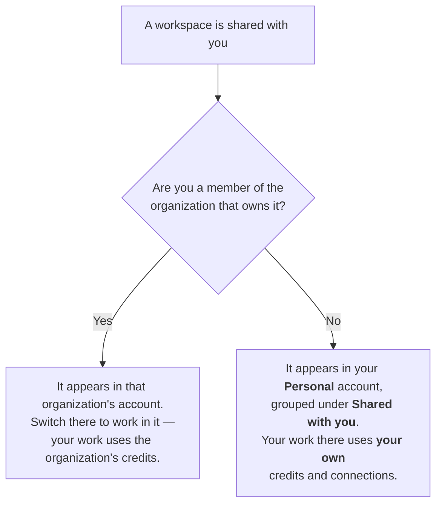

An organization is a company directory and account context in Script.it. It brings together members, organization-shared workspaces, billing, and usage controls.

You always have a **Personal** account, and you can create or join more than one organization. You use one active account at a time.

## Personal and organization accounts

| Account | Best for | Included access |
|---|---|---|
| Personal | Your own work | Your private workspace, workspaces shared with you from outside your organizations, and your personal credits |
| Organization | Company work | The organization's workspaces (shared org-wide or with you directly), workspace integrations, and the organization's credits and limits |

Switching accounts changes which workspaces and integrations are available and which account pays for new usage. It does not move or delete scripts, sessions, or connections.

Every shared workspace appears in exactly one of your accounts, decided by membership in the organization that owns it:

The account switcher lists only organizations you are a member of. Being invited to a single workspace never adds an organization to your switcher — see [Working in a workspace shared from outside](#working-in-a-workspace-shared-from-outside) below.

<Note>
  Creating an organization does not automatically share a workspace with it. Create workspaces privately, then explicitly add people or an organization from the workspace's access settings.
</Note>

## Working in a workspace shared from outside

When someone shares a workspace with you and you are **not** a member of the organization that owns it, the workspace shows up in your **Personal** account under **Shared with you**, labeled with the owner's name.

- You collaborate on the same scripts and files as everyone else in the workspace.
- Everything you run there uses **your own credits**. Your own connections stay yours: an integration you have connected resolves to your account, not the owner's.
- Connections other people have shared **into that workspace** are available to you as well, whoever owns the workspace. Using one calls the sharer's upstream account, not yours.
- If a company owns the workspace, you appear in its member list as a **Guest**, with no organization permissions. See [Guests](/governance/roles-and-permissions#guests).
- If you later join the owning organization, the workspace moves out of **Shared with you** and becomes available through that organization's account instead. Any triggers you created on it start running under the organization from then on — the invitation screen shows this before you accept.

## Switch your active account

Use the account switcher in the sidebar or the Settings header:

1. Open the account switcher.
2. Choose **Personal** or an organization.
3. Wait for Script.it to synchronize your workspace access.

Script.it opens a new session after the switch and updates your workspace access.

## Create and manage an organization

Open **Settings → Organization** to create an organization or manage one you belong to. An organization's **⋮** menu offers what your role allows: **Invite members**, **Change icon**, **Rename organization**, and, for the Owner, **Transfer ownership** and **Delete organization**.

New organizations do not receive Personal free credits. To run billable actions, an organization must choose a credit plan. You can switch back to Personal at any time.

The Owner can delete an organization only after its paid subscription has ended. Deleting it removes organization membership and inherited workspace access; it does not delete a workspace that still has another Editor.

## Roles

Everyone in an organization holds one role. Each role is a set of permissions that admins can change.

| Role | In short |
|---|---|
| Owner | Holds every permission. Exactly one per organization. |
| Admin | Manages members, workspaces, integrations, domains, and organization settings. No billing by default. |
| Billing admin | Manages the plan, payment details, and spending. Doesn't manage members. |
| Member | Creates workspaces, connects and shares integrations, runs and publishes scripts. |

Your organization can also define its own roles, and give one member exceptions to their role. See [Roles and permissions](/governance/roles-and-permissions) for every permission and its default.

Who can change whom follows one rule: you can manage only people who hold nothing you lack. An Admin can change or remove another Admin with the same permissions, but not a Billing admin, who holds billing permissions an Admin doesn't. Nobody but the Owner can act on the Owner, and an organization always keeps its Owner. Ownership moves only by [transferring it](/governance/admin-oversight#transfer-ownership).

## Invite members

People with **Manage members** can invite others. Owners and Admins hold it by default.

1. In **Settings → Organization**, open the organization's **⋮** menu and select **Invite members**, or use the invite field in the active organization's settings.
2. Enter an email address and choose a role. You can offer only roles whose permissions you hold, so with the built-in roles an Admin can invite Admins and Members but not Billing admins.
3. Send the invitation.

The recipient can accept or decline the invitation in Script.it. Accepting adds them to the directory but does not switch their active account.

## Configure domain auto-join

Domain auto-join lets people with a verified work email join your organization automatically when they sign in. You need **Manage verified domains**, which Owners and Admins hold by default.

1. Open **Settings → Organization** with the organization active, and expand **Domain auto-join**.
2. Enter your company's domain and select **Claim domain**.
3. Add the DNS TXT record Script.it shows at your domain provider. Add it within 24 hours: the record is shown only once. If it expires, select **New token** for a new one.
4. Return to Script.it and select **Verify**.

After verification, people whose email matches the domain join as members and can access workspaces shared with the organization. An organization can verify several domains, but a domain can belong to only one organization. Public and disposable email domains can't be claimed.

A verified domain also matters for [single sign-on](/governance/sso): it lets Script.it link existing accounts on that domain automatically.

## Share a workspace with an organization

Any Editor of a workspace can open it to the whole organization that owns it, if they hold **Share workspaces with everyone**. Every role holds it by default. Removing the organization's access needs the same permission.

1. Open **Settings → Sharing → Workspaces**.
2. Select **Members** for the workspace.
3. Search for a person or the organization.
4. Choose **Can edit** or **Can view**, then send the invitation or select **Add** for the organization.

All current and future organization members inherit the organization's workspace role. Direct grants to individual people remain separate, and the strongest applicable role wins. A workspace can be shared this way only with the organization that owns it.

### What sharing a workspace exposes

Connections are shared with workspaces, not directly with organizations. A connection shared into a workspace reaches everyone that workspace grants access to: the organization's members, and any guest invited from outside it.

So deciding who can open workspaces is also deciding who can reach the connections in them. Admins control that exposure with permissions:

- **Share workspaces with everyone** decides who can open a workspace to the whole organization. Remove it from a role or a member to keep workspaces to the people invited directly.
- **Invite people outside the organization** decides who can bring in guests. Only Owners and Admins hold it by default.
- **Share integrations** decides who can put a connection's credentials into a workspace at all.

To limit what anyone can do with a shared connection, add an [integration policy](/governance/integration-policies). See [Workspaces](/account/workspace) and [Billing](/account/billing) for details.
