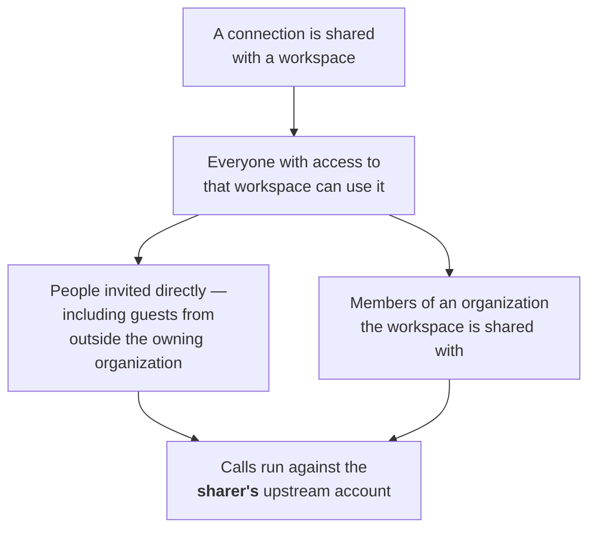

Workspaces are where you collaborate in Script.it. Each workspace holds its own scripts and gives people and organizations a shared place to use integrations that have been shared with the workspace.

When you sign up, Script.it creates a private workspace in your Personal account automatically. Each organization you join gives you a Private workspace there too, unless the organization turns that off. You can create additional workspaces for teams, clients, departments, or any other collaboration boundary.

## Signing up

To create an account, go to [app.script.it/login](https://app.script.it/login). You can sign in with Google or with an email address and password. If your company uses [single sign-on](/governance/sso), use the sign-in link it gives you instead. No credit card is required to get started — your account comes with free included credits right away.

<Note>
  New accounts are on the free plan by default. You can upgrade to a paid plan at any time from **Settings → Billing**. See [Billing, credits, and plans](/account/billing) for details.
</Note>

## What workspaces contain

Each workspace contains:

- **Scripts** - reusable workflows with blocks, source files, assets, and trigger configuration.
- **Members** - the people and organizations that can view, run, or edit scripts in the workspace.
- **Shared integrations** - connected accounts or custom integration types that members can use.
- **Triggers** - rules that run scripts automatically on a schedule or in response to events.

Scripts are shared across sessions. If a member edits a script in one session, the updated script is visible everywhere that workspace is available.

Session files are separate. Files produced during a run belong to the session that produced them, not to the workspace's script source. See [Session files](/sessions/files) for details.

## Roles

Workspaces have two roles:

| Role | What they can do |
|---|---|
| Editor (**Can edit**) | Edit scripts, invite or remove members, change member roles, and rename or delete the workspace. |
| Reader (**Can view**) | View and run scripts, and use integrations shared with the workspace. Readers cannot edit scripts or manage members. |

<Note>
  Workspace role does not grant the right to manage an integration. Sharing, editing, rotating credentials, and deleting a connection or custom integration type are controlled by that integration's own editors. A workspace Editor can still remove a shared integration from the workspace with **Remove from workspace**. See [Connect integrations](/integrations/connecting#who-can-do-what-with-a-connection).
</Note>

Your organization's permissions can narrow what you do in a workspace. For example, an organization can turn off creating workspaces or inviting people from outside it. See [Roles and permissions](/governance/roles-and-permissions).

## Sharing with people and organizations

New workspaces are private to their creator. Creating a workspace while an organization is active does not share it automatically.

From the workspace's **Members** dialog, an Editor can invite people and, in an organization workspace, the organization itself:

- **People in the organization.** Any Editor can invite a member of the organization that owns the workspace, or anyone whose email is on one of its [verified domains](/account/organizations#configure-domain-auto-join).
- **People outside the organization.** Inviting someone else into an organization workspace makes them a guest. It needs **Invite people outside the organization**, which only Owners and Admins hold by default. The dialog warns you when the address is outside the organization.
- **The whole organization.** An Editor who holds **Share workspaces with everyone** can give the owning organization **Can edit** or **Can view** access. Every role holds it by default. All current and future organization members inherit that role.
- **In your Personal account,** any Editor of a workspace can invite anyone.

Direct and organization access coexist. If you have both, Script.it applies the stronger role.

A shared workspace appears in exactly one of each person's accounts. Members of the owning organization reach it through that organization's account. A person invited from **outside** the organization sees it in their own **Personal** account under **Shared with you** — they collaborate on the same scripts, and their runs use their own credits, their own connections, and any connection shared into the workspace itself. See [Working in a workspace shared from outside](/account/organizations#working-in-a-workspace-shared-from-outside).

Script.it keeps at least one Editor for every workspace. Removing an organization's access never leaves the workspace without someone who can manage it.

See [Organizations and active accounts](/account/organizations) for account switching, roles, and organization invitations.

## Shared integrations

Workspaces can receive two kinds of shared integrations:

- **Shared connections** - a collaborator shares their connected account with the workspace. The people it authorizes call that integration using the sharer's upstream account.
- **Shared custom integration types** - a collaborator shares the definition for an integration, such as the base URL, auth mode, OAuth client, or OpenAPI spec. Each authorized person connects their own credentials through that type.

Sharing a connection authorizes the account, not just a specific script or location — the people it reaches can use it from any of their sessions and scripts, and the same connection can be shared with multiple workspaces.

A share reaches **everyone the workspace grants access to**, however that access arrived:

Who owns the workspace does not narrow this. What narrows it:

- **Who can open the workspace.** Organization permissions decide who can share a workspace with everyone and who can invite guests. Admins can remove those permissions from roles or members. See [What sharing a workspace exposes](/account/organizations#what-sharing-a-workspace-exposes).
- **What the connection allows.** Its editors can store a permission policy, such as read-only. It applies to every call through the connection.
- **What each person may call.** An organization can limit a member's Integration calls across every integration.

See [Integration policies](/governance/integration-policies) for both kinds of limit.

<Warning>
  When you share an OAuth or API-key connection, the people the workspace authorizes can make requests under your authorization at the upstream provider. Those requests may appear as you in the provider's logs or audit trail.
</Warning>

## Accessing settings

To manage workspaces, open **Settings → Sharing → Workspaces**. From there you can:

- Create a workspace
- Rename or delete a workspace
- Move a workspace to another account (see [Move a workspace](/governance/admin-oversight#move-a-workspace-to-another-account))
- Invite people or add an organization
- Change a member's role
- Remove members
- Review what integrations are shared with a workspace

To manage account-level settings, open **Settings**. From there you can:

- View and edit your profile information
- Check your credit balance and usage history
- Upgrade your plan or manage billing
- Review connected integrations and revoke access if needed

The pages in this section cover billing and security in detail.
