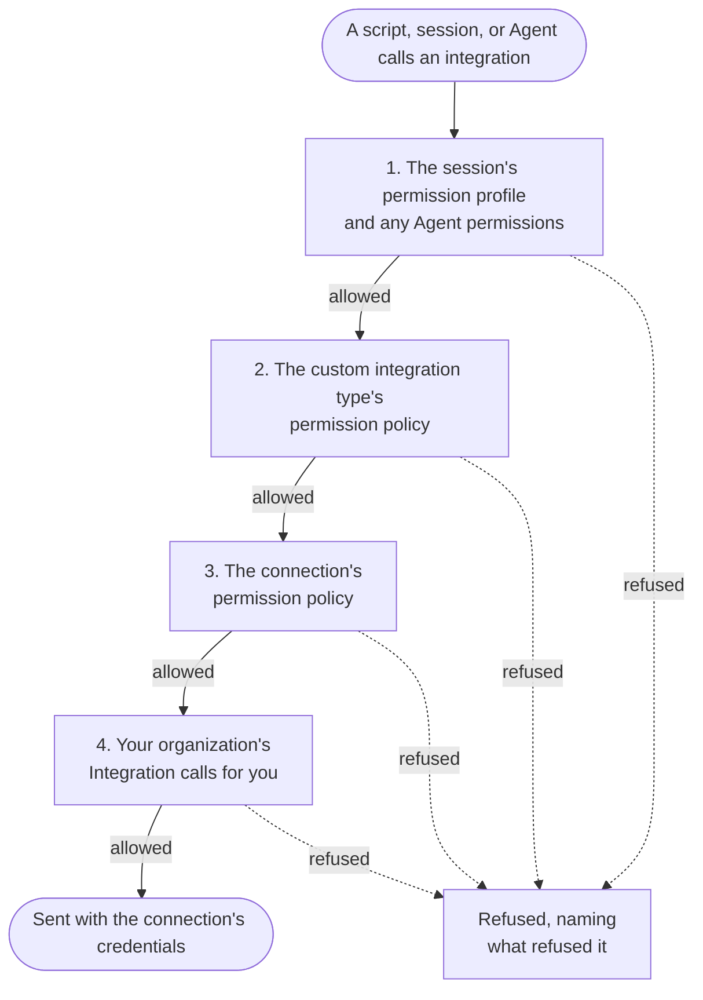

Three layers decide what happens in Script.it. Each one answers a different question, and each one can only narrow what the others allow.

| Layer | The question it answers | Who sets it | Where |
|---|---|---|---|
| [Organization roles and permissions](/governance/roles-and-permissions) | What may this person do in the organization? | Owners and admins | **Settings → Organization** |
| [Access to workspaces and integrations](/account/workspace) | Which workspaces, connections, and custom integration types can this person reach? | Whoever shares them | **Settings → Sharing** and **Settings → Integrations** |
| [Permission profiles](/governance/permission-profiles) | What may this session or Agent do right now? | The person running the session, and whoever writes the Agent | The chat composer, and the Agent's definition |

On top of these, whoever manages a connection or a custom integration type can store an [integration policy](/governance/integration-policies) that limits every call through it.

## Organization roles and permissions

Everyone in an organization has a role: Owner, Admin, Billing admin, Member, or a custom role your organization defines. A role is a named set of permissions, such as **Create workspaces**, **Share integrations**, or **Publish scripts publicly**.

Admins can change what a role holds, create new roles, and give one member exceptions. The same screen sets requirements, such as **Must use two-factor authentication**. It also sets limits on what a member's integration calls and Agent models may be.

See [Roles and permissions](/governance/roles-and-permissions) for every permission and its default.

## Access to workspaces and integrations

Workspaces hold scripts, and people reach them as an Editor (**Can edit**) or a Reader (**Can view**). A workspace can also be opened to everyone in the organization that owns it.

Integrations are reached in three ways:

- **Your own connections.** You connected the account, so you own it.
- **Connections shared into a workspace you're in.** You can use them, and calls go out as the person who shared them.
- **Custom integration types shared with you.** You connect your own credentials through the shared definition.

Using an integration and managing it are separate. Managing a connection — sharing it, editing it, rotating its credentials — needs editor rights on that connection. A workspace role never grants them. See [Connect integrations](/integrations/connecting#who-can-do-what-with-a-connection).

## Permission profiles and Agent permissions

Every session runs under a permission profile you pick in the chat composer. **Full** is the default and adds no restriction. A restricted profile, such as **Chat**, limits which files the session reads and writes, whether it has a network, and which integration calls it makes.

An Agent runs under its own permission, inside the limits of whatever called it. An Agent never gets more than its caller.

Triggers run under **Full**, with the authority and connections of the person who owns the trigger. To handle untrusted input from a trigger, run an Agent with a restricted permission. See [Permission profiles](/governance/permission-profiles).

## How an integration call is checked

When a script, session, or Agent calls an integration, Script.it checks every layer in order. Any one of them can refuse the call.

- A step with nothing set allows the call. A connection with no policy limits nothing.
- The type's policy applies only to connections of a custom integration type.
- The connection's policy applies to everyone who calls through it, including the person who owns it.
- Your organization's Integration calls follow you, not the connection. They limit your calls through any connection, including one a teammate shared.

Before any of these checks, you need access to the connection at all: your own, one shared into a workspace you're in, or one you were made an editor of.

## Who is never limited

- The organization's Owner holds every permission. Role changes, member exceptions, and requirements never apply to them.
- A Personal account has no organization limits.
- A connection's or a type's permission policy still applies to everyone, Owners included. It belongs to the integration, not the organization.

## Next steps

<CardGroup cols={2}>
  <Card title="Roles and permissions" icon="key-round" href="/governance/roles-and-permissions">
    Every permission, its default for each role, and how to change them.
  </Card>
  <Card title="Integration policies" icon="shield" href="/governance/integration-policies">
    Limit what anyone can do through a connection or a custom integration type.
  </Card>
  <Card title="Permission profiles" icon="sliders-horizontal" href="/governance/permission-profiles">
    Run a session or an Agent with only the access it needs.
  </Card>
  <Card title="Overseeing your organization" icon="eye" href="/governance/admin-oversight">
    See every workspace and integration, and act on them.
  </Card>
</CardGroup>
